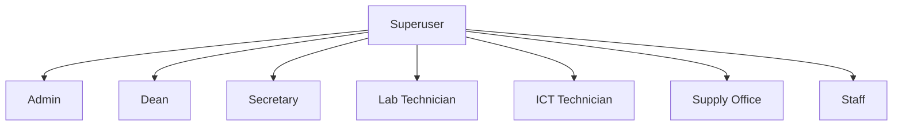
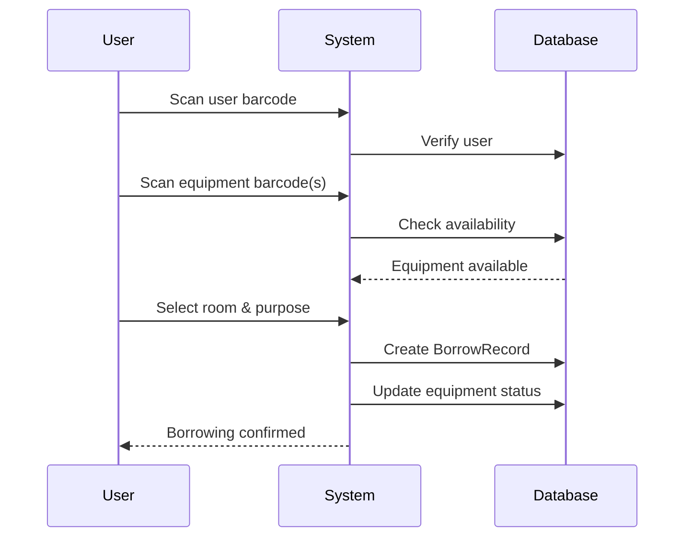
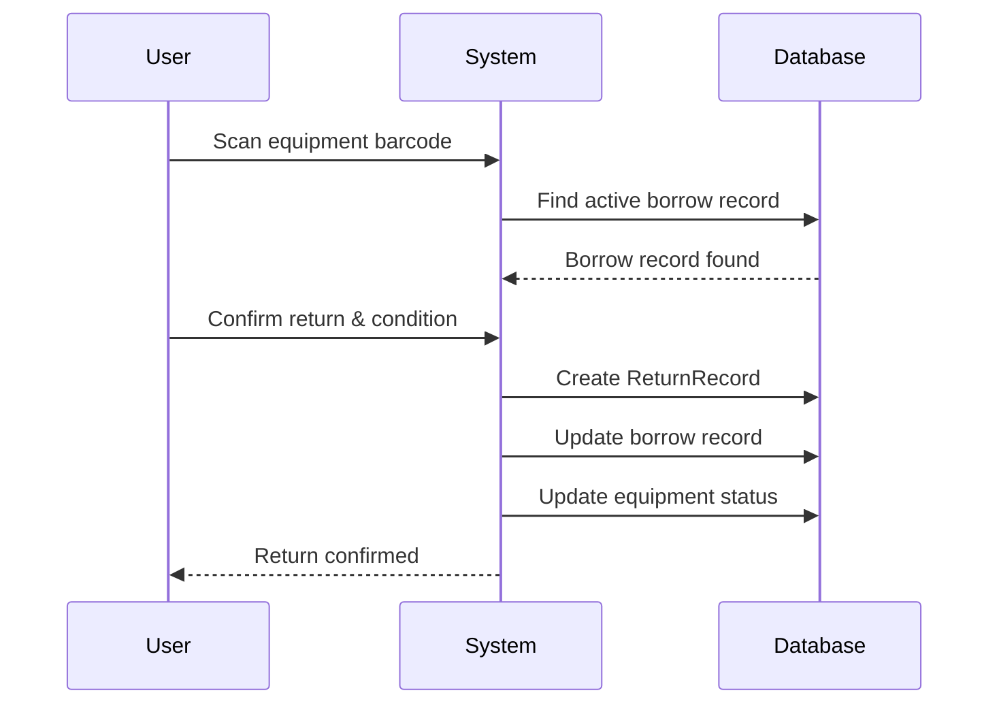
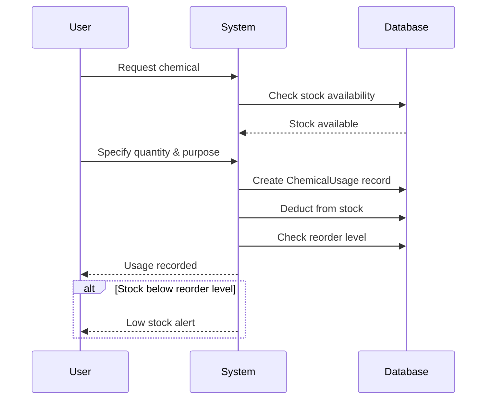

# System Overview

## Introduction

The **Equipment & Inventory Management System (EIMS)** is a comprehensive web application designed to manage equipment, inventory, and chemical supplies across multiple departments in an educational institution. The system supports multiple user roles with different permissions and workflows.

## Current Architecture

### Technology Stack

#### Backend (Django)
- **Framework**: Django 5.0
- **API**: Django REST Framework
- **Authentication**: Token-based authentication
- **Database**: SQLite (development), MySQL (production-ready)
- **File Storage**: Cloudinary for images and barcodes
- **Barcode Generation**: Python `barcode` library with PIL

#### Frontend (Vue 3)
- **Framework**: Vue 3 (Composition API)
- **Router**: Vue Router 4
- **State Management**: Vuex + Pinia
- **HTTP Client**: Axios
- **UI Components**: Custom components with Tailwind CSS
- **Charts**: Chart.js, ApexCharts, ECharts
- **Barcode Scanning**: Quagga2, ZXing, html5-qrcode

#### Infrastructure
- **Development Server**: Django dev server (port 8000) + Vue dev server (port 8080)
- **CORS**: Enabled for cross-origin requests
- **Static Files**: WhiteNoise for Django static files
- **Media Files**: Cloudinary CDN

### Project Structure

```
.
├── Django/                      # Backend application
│   ├── capstone/               # Django project settings
│   │   ├── settings.py         # Configuration
│   │   ├── urls.py             # Main URL routing
│   │   └── serializers.py      # Shared serializers
│   ├── users/                  # User management app
│   │   ├── models.py           # User, Department, Room models
│   │   ├── views.py            # Authentication & user endpoints
│   │   ├── serializers.py      # User serializers
│   │   └── permissions.py      # Custom permissions
│   ├── secretary/              # Item management app
│   │   ├── models.py           # Item, ItemInstance, BorrowRecord
│   │   ├── views.py            # Item CRUD & borrowing logic
│   │   └── serializers.py      # Item serializers
│   ├── labtech/                # Laboratory management app
│   │   ├── models.py           # Equipment, Apparatus, Chemical models
│   │   ├── views.py            # Lab equipment endpoints
│   │   └── serializers.py      # Lab serializers
│   ├── supply/                 # Supply office app
│   │   ├── models.py           # Chemical assignments
│   │   ├── views.py            # Supply operations
│   │   └── serializers.py      # Supply serializers
│   ├── staff/                  # Staff requests app
│   │   ├── models.py           # Transfer, Replace, Dispose requests
│   │   ├── views.py            # Request handling
│   │   └── serializers.py      # Request serializers
│   ├── media/                  # Local media files (dev)
│   ├── barcode/                # Generated barcodes
│   └── manage.py               # Django management script
│
└── eims-vue/                   # Frontend application
    ├── src/
    │   ├── components/         # Reusable components
    │   │   ├── UserType/       # Role-specific sidebars
    │   │   ├── charts/         # Chart components
    │   │   └── buttons/        # Button components
    │   ├── views/              # Page components
    │   │   ├── Admin/          # Admin pages
    │   │   ├── Secretary/      # Secretary pages
    │   │   ├── Labtech/        # Lab technician pages
    │   │   ├── Supply/         # Supply office pages
    │   │   ├── Dean/           # Dean pages
    │   │   └── Ictc/           # ICT pages
    │   ├── stores/             # Pinia stores
    │   ├── router/             # Vue Router config
    │   ├── utils/              # Utility functions
    │   │   └── api.js          # API helper functions
    │   ├── App.vue             # Root component
    │   └── main.js             # Application entry
    ├── public/                 # Static assets
    └── package.json            # Dependencies
```

## System Modules

### 1. Users Module
**Purpose**: User authentication, authorization, and organizational structure

**Key Features**:
- User registration and authentication
- Role-based access control (8 user types)
- Department management
- Room management
- User profile with barcode generation
- Password management

**Models**: `User`, `Department`, `Room`

### 2. Secretary Module
**Purpose**: General equipment and item management

**Key Features**:
- Item catalog management
- Item instance tracking (consumables & non-consumables)
- Borrowing workflow
- Return processing
- Damage tracking
- Category management
- Barcode scanning for items

**Models**: `Item`, `ItemInstance`, `Category`, `BorrowRecord`, `ReturnRecord`

### 3. Labtech Module
**Purpose**: Laboratory equipment, apparatus, and chemical management

**Key Features**:
- Equipment management (computers, projectors, etc.)
- Apparatus management (lab glassware, tools)
- Chemical inventory tracking
- Chemical usage recording
- Equipment borrowing and returns
- Apparatus borrowing and returns
- Subject management
- Lab category management
- Low stock alerts

**Models**: `Equipment`, `EquipmentInstance`, `Apparatus`, `ApparatusInstance`, `Chemical`, `ChemicalStock`, `ChemicalUsage`, `Subject`, `LabCategory`, `Unit`

### 4. Supply Module
**Purpose**: Supply office operations and chemical distribution

**Key Features**:
- Chemical assignment to users/rooms
- Volume tracking
- Assignment history
- Integration with chemical inventory

**Models**: `ChemicalAssignment`

### 5. Staff Module
**Purpose**: Staff equipment requests and lifecycle management

**Key Features**:
- Transfer requests (move equipment between locations)
- Replace requests (request equipment replacement)
- Dispose requests (request equipment disposal)
- Approval workflows
- Request status tracking

**Models**: `TransferRequest`, `ReplaceRequest`, `DisposeRequest`, `Status`

## User Roles & Permissions

### Role Hierarchy



### Role Capabilities

| Role | Capabilities |
|------|-------------|
| **Superuser** | Full system access, all CRUD operations |
| **Admin** | User management, department/room management, system configuration |
| **Secretary** | Item borrowing/returns, item management, general equipment tracking |
| **Lab Technician** | Lab equipment, apparatus, chemicals management, borrowing workflows |
| **ICT Technician** | ICT equipment management |
| **Supply Office** | Chemical assignments, equipment assignments, supply tracking |
| **Dean** | View reports, oversight of all operations, assigned equipment tracking |
| **Staff** | Borrow equipment, submit transfer/replace/dispose requests |

## Key Workflows

### 1. Equipment Borrowing Workflow



### 2. Equipment Return Workflow



### 3. Chemical Usage Workflow



## Data Flow Architecture

### Request Flow

```
Client (Vue) → Axios → Django REST API → Django Views → Models → Database
                ↓                                                    ↑
            Token Auth                                              |
                ↓                                                    |
         Verify Permissions                                         |
                ↓                                                    |
         Process Request -------------------------------------------|
                ↓
         Serialize Response
                ↓
         Return JSON
```

### File Upload Flow

```
Client → Multipart Form Data → Django View → Cloudinary API → CDN
                                      ↓
                                 Save URL to DB
```

### Barcode Generation Flow

```
Create Instance → Generate Barcode → Upload to Cloudinary → Save URL → Display
```

## Performance Characteristics

### Current System Metrics

- **Database**: SQLite (single file, suitable for small-medium deployments)
- **Concurrent Users**: Designed for 50-100 concurrent users
- **Response Time**: 100-500ms for typical API calls
- **File Storage**: Cloudinary CDN (fast global delivery)
- **Barcode Generation**: On-demand, cached in Cloudinary

### Bottlenecks

1. **SQLite Limitations**: Not suitable for high-concurrency writes
2. **Separate Frontend/Backend**: Additional network hop
3. **Token Authentication**: Requires token refresh management
4. **No Server-Side Rendering**: Slower initial page loads
5. **Client-Side State Management**: Complex state synchronization

## Security Features

### Current Implementation

1. **Authentication**: Token-based (Django REST Framework)
2. **Authorization**: Role-based permissions
3. **CSRF Protection**: Django CSRF middleware
4. **CORS**: Configured for specific origins
5. **Password Hashing**: Django's PBKDF2 algorithm
6. **SQL Injection**: Protected by Django ORM
7. **XSS Protection**: Vue's template escaping

### Security Considerations

- Tokens stored in localStorage (vulnerable to XSS)
- No rate limiting implemented
- No two-factor authentication
- File uploads not validated extensively
- No audit logging for sensitive operations

## Scalability Considerations

### Current Limitations

1. **Database**: SQLite not suitable for production scale
2. **File Storage**: Dependent on Cloudinary limits
3. **Session Management**: In-memory (not distributed)
4. **Caching**: No caching layer implemented
5. **Background Jobs**: No task queue for long-running operations

### Recommended Improvements (for Next.js migration)

1. **Database**: PostgreSQL with connection pooling
2. **Caching**: Redis for session and data caching
3. **CDN**: Vercel Edge Network + Cloudinary
4. **Background Jobs**: Vercel Cron or external queue
5. **Monitoring**: Application performance monitoring
6. **Logging**: Structured logging with aggregation

## Integration Points

### External Services

1. **Cloudinary**: Image and barcode storage
   - API Key authentication
   - Upload API for file storage
   - Transformation API for image optimization

### Internal APIs

1. **Authentication API**: `/api/login`, `/api/user-info`
2. **Items API**: `/api/items`, `/api/items/{id}/instances`
3. **Equipment API**: `/api/equipments`, `/api/equipment/{id}/instances`
4. **Chemicals API**: `/api/chemicals`, `/api/chemical/{id}/stocks`
5. **Borrowing API**: `/api/borrow`, `/api/return`
6. **Dashboard API**: `/api/dashboard`, `/api/labtech-dashboard`

## Next Steps

This overview provides the foundation for understanding the current system. The following documents will dive deeper into:

- Data models and relationships (02-data-models.md)
- API endpoints and request/response formats (03-api-endpoints.md)
- Authentication and authorization details (04-authentication-authorization.md)
- Business logic and validation rules (05-business-logic.md)
- Frontend component structure (06-frontend-components.md)
- File storage and barcode implementation (07-file-storage-barcodes.md)
