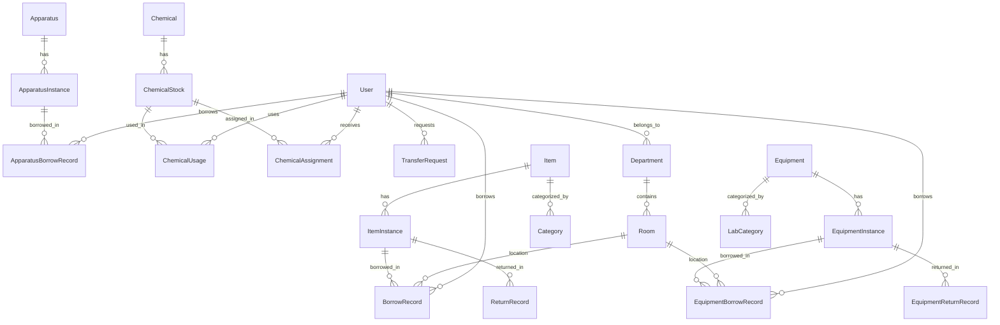

# Data Models

## Overview

This document provides a comprehensive overview of all data models in the EIMS, their fields, relationships, and constraints. Understanding these models is crucial for the migration to Next.js with Prisma/Drizzle ORM.

## Entity Relationship Diagram



## Users Module Models

### User Model

**File**: `Django/users/models.py`

```python
class User(AbstractUser):
    # Role flags
    is_secretary = models.BooleanField(default=False)
    is_dean = models.BooleanField(default=False)
    is_admin = models.BooleanField(default=False)
    is_staff = models.BooleanField(default=False)
    is_superuser = models.BooleanField(default=False)
    is_supply = models.BooleanField(default=False)
    is_labtech = models.BooleanField(default=False)
    is_ictc = models.BooleanField(default=False)
    
    # Profile fields
    department = models.ForeignKey(Department, on_delete=models.CASCADE, blank=True, null=True)
    contact_number = models.CharField(max_length=20, blank=True, null=True)
    custom_id = models.IntegerField(unique=True, null=True, blank=True)
    barcode = models.ImageField(upload_to='user_barcodes', blank=True, null=True)
    profile_picture = CloudinaryField('image', null=True, blank=True)
    barcode_value = models.CharField(max_length=100, unique=True, blank=True, null=True)
```

**Fields**:
| Field | Type | Constraints | Description |
|-------|------|-------------|-------------|
| username | CharField | unique, max_length=150 | Login username (inherited) |
| email | EmailField | max_length=254 | User email (inherited) |
| first_name | CharField | max_length=150 | User first name (inherited) |
| last_name | CharField | max_length=150 | User last name (inherited) |
| password | CharField | max_length=128 | Hashed password (inherited) |
| is_secretary | BooleanField | default=False | Secretary role flag |
| is_dean | BooleanField | default=False | Dean role flag |
| is_admin | BooleanField | default=False | Admin role flag |
| is_staff | BooleanField | default=False | Staff role flag |
| is_superuser | BooleanField | default=False | Superuser role flag |
| is_supply | BooleanField | default=False | Supply office role flag |
| is_labtech | BooleanField | default=False | Lab technician role flag |
| is_ictc | BooleanField | default=False | ICT technician role flag |
| department | ForeignKey | nullable | Department assignment |
| contact_number | CharField | max_length=20, nullable | Contact phone |
| custom_id | IntegerField | unique, nullable | Auto-generated ID for barcode |
| barcode | ImageField | nullable | User barcode image |
| profile_picture | CloudinaryField | nullable | Profile photo |
| barcode_value | CharField | unique, max_length=100 | Barcode string value |

**Methods**:
- `generate_custom_id()`: Auto-increment custom ID
- `generate_barcode()`: Create Code128 barcode
- `user_type()`: Return user role as string

**Relationships**:
- `department`: Many-to-One with Department
- `borrowrecords`: One-to-Many with BorrowRecord (as borrower)
- `equipmentborrowrecord`: One-to-Many with EquipmentBorrowRecord
- `apparatusborrowrecords`: One-to-Many with ApparatusBorrowRecord
- `chemicalusage`: One-to-Many with ChemicalUsage
- `received_chemicals`: One-to-Many with ChemicalAssignment

**Prisma Equivalent**:
```prisma
model User {
  id              Int       @id @default(autoincrement())
  username        String    @unique
  email           String    @unique
  firstName       String
  lastName        String
  password        String
  isSecretary     Boolean   @default(false)
  isDean          Boolean   @default(false)
  isAdmin         Boolean   @default(false)
  isStaff         Boolean   @default(false)
  isSuperuser     Boolean   @default(false)
  isSupply        Boolean   @default(false)
  isLabtech       Boolean   @default(false)
  isIctc          Boolean   @default(false)
  departmentId    Int?
  contactNumber   String?
  customId        Int?      @unique
  barcode         String?
  profilePicture  String?
  barcodeValue    String?   @unique
  createdAt       DateTime  @default(now())
  updatedAt       DateTime  @updatedAt
  
  department      Department?  @relation(fields: [departmentId], references: [id])
  borrowRecords   BorrowRecord[]
  equipmentBorrows EquipmentBorrowRecord[]
  // ... other relations
}
```

### Department Model

```python
class Department(models.Model):
    name = models.CharField(max_length=100)
```

**Fields**:
| Field | Type | Constraints | Description |
|-------|------|-------------|-------------|
| id | AutoField | primary_key | Auto-generated ID |
| name | CharField | max_length=100 | Department name |

**Relationships**:
- `users`: One-to-Many with User
- `rooms`: One-to-Many with Room

### Room Model

```python
class Room(models.Model):
    name = models.CharField(max_length=100)
    department = models.ForeignKey(Department, on_delete=models.CASCADE)
    location = models.CharField(max_length=100)
```

**Fields**:
| Field | Type | Constraints | Description |
|-------|------|-------------|-------------|
| id | AutoField | primary_key | Auto-generated ID |
| name | CharField | max_length=100 | Room name/number |
| department | ForeignKey | required | Department assignment |
| location | CharField | max_length=100 | Physical location |

**Relationships**:
- `department`: Many-to-One with Department
- `borrowrecords`: One-to-Many with BorrowRecord
- `equipmentborrowrecords`: One-to-Many with EquipmentBorrowRecord

## Secretary Module Models

### Item Model

**File**: `Django/secretary/models.py`

```python
class Item(models.Model):
    CONDITION_CHOICES = (
        ('Consumables', 'Consumables'),
        ('Non-Consumables', 'Non-Consumables'),
    )
    name = models.CharField(max_length=100)
    category = models.ForeignKey(Category, null=True, blank=True, on_delete=models.CASCADE)
    description = models.TextField(blank=True)
    model = models.CharField(max_length=100, blank=True, null=True)
    item_type = models.CharField(max_length=20, choices=CONDITION_CHOICES, default='Non-Consumables')
    quantity = models.PositiveIntegerField(default=0)
    created_at = models.DateTimeField(auto_now_add=True)
    updated_at = models.DateTimeField(auto_now=True)
```

**Fields**:
| Field | Type | Constraints | Description |
|-------|------|-------------|-------------|
| id | AutoField | primary_key | Auto-generated ID |
| name | CharField | max_length=100 | Item name |
| category | ForeignKey | nullable | Item category |
| description | TextField | blank | Item description |
| model | CharField | max_length=100, nullable | Model number |
| item_type | CharField | choices, default='Non-Consumables' | Consumable or not |
| quantity | PositiveIntegerField | default=0 | Total quantity (calculated) |
| created_at | DateTimeField | auto_now_add | Creation timestamp |
| updated_at | DateTimeField | auto_now | Last update timestamp |

**Methods**:
- `total_instances()`: Count all instances
- `available_instances()`: Count available (not borrowed) instances
- `update_total_quantity()`: Recalculate total quantity
- `calculate_total_quantity()`: Update quantity from instances

**Relationships**:
- `category`: Many-to-One with Category
- `instances`: One-to-Many with ItemInstance

### ItemInstance Model

```python
class ItemInstance(models.Model):
    CONDITION_CHOICES = (
        ('Good', 'Good'),
        ('Fair', 'Fair'),
        ('Poor', 'Poor'),
        ('Damaged', 'Damaged'),
    )
    
    item = models.ForeignKey(Item, on_delete=models.CASCADE, related_name='instances')
    unit_cost = models.DecimalField(max_digits=10, decimal_places=2, default=0)
    quantity = models.PositiveIntegerField(default=0)
    purchase_date = models.DateField(null=True, blank=True)
    serial_number = models.CharField(max_length=100, unique=True, null=True, blank=True)
    inventory_number = models.CharField(max_length=100, unique=True, null=True, blank=True)
    current_condition = models.CharField(max_length=10, choices=CONDITION_CHOICES, default='Good')
    last_condition = models.CharField(max_length=10, choices=CONDITION_CHOICES, blank=True, null=True)
    barcode = CloudinaryField('barcode', folder='barcode/item_barcodes', null=True, blank=True)
    useful_life = models.PositiveIntegerField(null=True, blank=True)
```

**Fields**:
| Field | Type | Constraints | Description |
|-------|------|-------------|-------------|
| id | AutoField | primary_key | Auto-generated ID |
| item | ForeignKey | required | Parent item |
| unit_cost | DecimalField | max_digits=10, decimal_places=2 | Cost per unit |
| quantity | PositiveIntegerField | default=0 | Quantity (1 for non-consumables) |
| purchase_date | DateField | nullable | Purchase date |
| serial_number | CharField | unique, nullable | Serial number |
| inventory_number | CharField | unique, nullable | Inventory tracking number |
| current_condition | CharField | choices, default='Good' | Current condition |
| last_condition | CharField | choices, nullable | Previous condition |
| barcode | CloudinaryField | nullable | Barcode image URL |
| useful_life | PositiveIntegerField | nullable | Expected lifespan in years |

**Methods**:
- `generate_barcode()`: Create and upload Code128 barcode
- `borrow_count()`: Count borrow records
- `get_current_borrow_record()`: Get active borrow
- `get_last_borrow_record()`: Get most recent return

**Signals**:
- `post_save`: Generate barcode after creation
- `post_delete`: Update parent item quantity, delete barcode

### Category Model

```python
class Category(models.Model):
    name = models.CharField(max_length=100)
    image = models.ImageField(upload_to='category_images', null=True, blank=True)
```

**Fields**:
| Field | Type | Constraints | Description |
|-------|------|-------------|-------------|
| id | AutoField | primary_key | Auto-generated ID |
| name | CharField | max_length=100 | Category name |
| image | ImageField | nullable | Category icon/image |

### BorrowRecord Model

```python
class BorrowRecord(models.Model):
    item_instance = models.ForeignKey(ItemInstance, on_delete=models.CASCADE, related_name='borrowrecords')
    quantity = models.PositiveIntegerField(default=0)
    borrower = models.ForeignKey(User, on_delete=models.CASCADE, related_name='currently_borrowed_items', blank=True, null=True)
    custom_borrower = models.TextField(blank=True, null=True)
    room = models.ForeignKey(Room, on_delete=models.CASCADE, null=True, blank=True)
    borrow_date = models.DateTimeField(auto_now_add=True)
    duration = models.PositiveIntegerField(null=True, blank=True)
    return_date = models.DateTimeField(null=True, blank=True)
    purpose = models.TextField(blank=True, null=True)
```

**Fields**:
| Field | Type | Constraints | Description |
|-------|------|-------------|-------------|
| id | AutoField | primary_key | Auto-generated ID |
| item_instance | ForeignKey | required | Borrowed item instance |
| quantity | PositiveIntegerField | default=0 | Quantity borrowed |
| borrower | ForeignKey | nullable | Registered user borrower |
| custom_borrower | TextField | nullable | Non-registered borrower name |
| room | ForeignKey | nullable | Destination room |
| borrow_date | DateTimeField | auto_now_add | Borrow timestamp |
| duration | PositiveIntegerField | nullable | Expected duration (days) |
| return_date | DateTimeField | nullable | Actual return timestamp |
| purpose | TextField | nullable | Purpose of borrowing |

**Validation**:
- Either `borrower` OR `custom_borrower` must be provided (not both)

**Methods**:
- `get_borrower()`: Return borrower name (user or custom)

### ReturnRecord Model

```python
class ReturnRecord(models.Model):
    item_instance = models.ForeignKey(ItemInstance, on_delete=models.CASCADE)
    borrow_record = models.OneToOneField(BorrowRecord, on_delete=models.CASCADE)
    return_date = models.DateTimeField(default=timezone.now)
    condition_on_return = models.TextField(blank=True, null=True)
    notes = models.TextField(blank=True, null=True)
```

**Fields**:
| Field | Type | Constraints | Description |
|-------|------|-------------|-------------|
| id | AutoField | primary_key | Auto-generated ID |
| item_instance | ForeignKey | required | Returned item instance |
| borrow_record | OneToOneField | required | Associated borrow record |
| return_date | DateTimeField | default=now | Return timestamp |
| condition_on_return | TextField | nullable | Condition notes |
| notes | TextField | nullable | Additional notes |

## Labtech Module Models

### Equipment Model

```python
class Equipment(models.Model):
    CONDITION_CHOICES = (
        ('Good', 'Good'),
        ('Fair', 'Fair'),
        ('Poor', 'Poor'),
        ('Damaged', 'Damaged'),
    )
    
    name = models.CharField(max_length=100)
    category = models.ForeignKey(LabCategory, null=True, blank=True, on_delete=models.CASCADE)
    model = models.CharField(max_length=100, blank=True, null=True)
    description = models.TextField(blank=True)
    quantity = models.PositiveIntegerField(default=0)
    created_at = models.DateTimeField(auto_now_add=True)
    updated_at = models.DateTimeField(auto_now=True)
```

**Similar structure to Item model, but for laboratory equipment**

### EquipmentInstance Model

```python
class EquipmentInstance(models.Model):
    equipment = models.ForeignKey(Equipment, on_delete=models.CASCADE, related_name='equipment_instances')
    quantity = models.PositiveIntegerField(default=0)
    unit_cost = models.DecimalField(max_digits=10, decimal_places=2, default=0)
    inventory_number = models.CharField(max_length=100, unique=True)
    useful_life = models.PositiveIntegerField(default=0)
    purchase_date = models.DateField(null=True, blank=True)
    serial_number = models.CharField(max_length=100, unique=True, null=True, blank=True)
    status = models.CharField(max_length=20, choices=STATUS_CHOICES, default='Inactive')
    current_condition = models.CharField(max_length=10, choices=CONDITION_CHOICES, default='Good')
    last_condition = models.CharField(max_length=10, choices=CONDITION_CHOICES, blank=True, null=True)
    barcode = CloudinaryField('barcode', folder='barcode/equipment_barcodes', null=True, blank=True)
```

**Similar to ItemInstance but with status field**

### Apparatus Model

```python
class Apparatus(models.Model):
    APPARATUS_TYPE = (
        ('Consumables', 'Consumables'),
        ('Non-Consumables', 'Non-Consumables'),
    )
    
    name = models.CharField(max_length=100)
    category = models.ForeignKey(LabCategory, null=True, blank=True, on_delete=models.CASCADE)
    apparatus_type = models.CharField(max_length=20, choices=APPARATUS_TYPE, default='Non-Consumables')
    description = models.TextField(blank=True, null=True)
    quantity = models.PositiveIntegerField()
```

**Laboratory apparatus (glassware, tools, etc.)**

### Chemical Model

```python
class Chemical(models.Model):
    UNIT_CHOICES = (
        ('l', 'l'),
        ('ml', 'ml'),
        ('g', 'g'),
        ('kg', 'kg'),
        ('gal', 'gal'),
    )
    
    name = models.CharField(max_length=100)
    unit = models.CharField(max_length=10, choices=UNIT_CHOICES, blank=True, null=True)
    description = models.TextField(blank=True)
    volume = models.DecimalField(max_digits=10, decimal_places=5, default=0)
    reorder_level = models.DecimalField(max_digits=10, decimal_places=2, default=0)
```

**Fields**:
| Field | Type | Constraints | Description |
|-------|------|-------------|-------------|
| id | AutoField | primary_key | Auto-generated ID |
| name | CharField | max_length=100 | Chemical name |
| unit | CharField | choices | Measurement unit |
| description | TextField | blank | Chemical description |
| volume | DecimalField | max_digits=10, decimal_places=5 | Total volume (calculated) |
| reorder_level | DecimalField | max_digits=10, decimal_places=2 | Low stock threshold |

**Methods**:
- `update_total_volume()`: Recalculate total from non-expired stocks

### ChemicalStock Model

```python
class ChemicalStock(models.Model):
    chemical = models.ForeignKey(Chemical, on_delete=models.CASCADE)
    price = models.DecimalField(max_digits=10, decimal_places=5, default=0)
    purchase_date = models.DateField(null=True, blank=True)
    inventory_number = models.CharField(max_length=100, unique=True)
    volume = models.DecimalField(max_digits=10, decimal_places=5, default=0)
    expiry_date = models.DateField(null=True, blank=True)
    barcode = CloudinaryField('barcode', folder='barcodes/chemical_barcode', null=True, blank=True)
```

**Individual chemical stock batches with expiry tracking**

### ChemicalUsage Model

```python
class ChemicalUsage(models.Model):
    requested_chemical = models.ForeignKey(ChemicalStock, on_delete=models.CASCADE)
    borrower = models.ForeignKey(User, on_delete=models.CASCADE)
    subject = models.ForeignKey(Subject, on_delete=models.SET_NULL, null=True, blank=True)
    room = models.ForeignKey(Room, on_delete=models.CASCADE, null=True, blank=True)
    quantity_used = models.DecimalField(max_digits=10, decimal_places=5, default=0)
    quantity_requested = models.DecimalField(max_digits=10, decimal_places=5, null=True, blank=True)
    request_unit = models.CharField(max_length=10, blank=True, null=True)
    purpose = models.TextField(null=True, blank=True)
    date_used = models.DateTimeField(auto_now_add=True)
```

**Tracks chemical consumption**

## Staff Module Models

### TransferRequest Model

```python
class TransferRequest(models.Model):
    STATUS_CHOICES = [
        ('AWAITING_ASSIGNEE_CONFIRMATION', 'Waiting for Assignee'),
        ('PENDING', 'Pending Approval'),
        ('APPROVED', 'Approval Granted'),
        ('REJECTED', 'Approval Denied'),
        ('ASSIGNEE_REJECTED', 'Declined by Assignee')
    ]
    
    item_instance = models.ForeignKey(ItemInstance, on_delete=models.CASCADE)
    requested_by = models.ForeignKey(User, on_delete=models.CASCADE, related_name='transfer_requests')
    requested_date = models.DateTimeField(auto_now_add=True)
    new_assignee = models.ForeignKey(User, on_delete=models.CASCADE, related_name='new_assigned_item')
    new_location = models.ForeignKey(Room, on_delete=models.CASCADE)
    transfer_reason = models.TextField(null=True, blank=True)
    processed_by = models.ForeignKey(User, on_delete=models.SET_NULL, null=True, blank=True, related_name='processed_transfer')
    processed_date = models.DateTimeField(null=True, blank=True)
    status = models.CharField(max_length=30, choices=STATUS_CHOICES, default='PENDING')
```

**Equipment transfer requests between users/locations**

### ReplaceRequest & DisposeRequest Models

Similar structure to TransferRequest, for equipment replacement and disposal workflows.

## Key Relationships Summary

### One-to-Many Relationships
- Department → Users
- Department → Rooms
- Item → ItemInstances
- Equipment → EquipmentInstances
- Chemical → ChemicalStocks
- User → BorrowRecords (as borrower)

### Many-to-One Relationships
- ItemInstance → Item
- BorrowRecord → ItemInstance
- BorrowRecord → User
- BorrowRecord → Room

### One-to-One Relationships
- ReturnRecord → BorrowRecord
